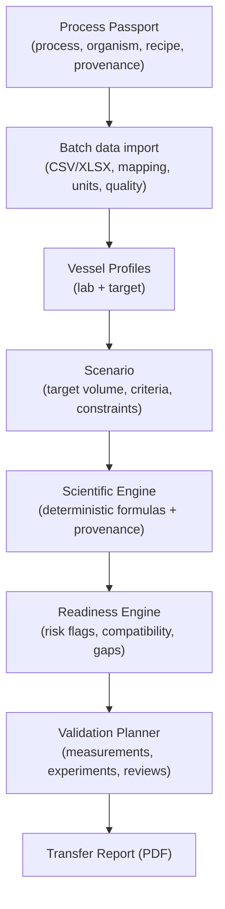

# 02 — Problem and Solution

**Purpose:** Explain the scale-up problem in engineering terms precise enough that developers understand *why* each module exists.
**Related:** [01_PROJECT_OVERVIEW.md](01_PROJECT_OVERVIEW.md) · [10_SCIENTIFIC_ENGINE.md](10_SCIENTIFIC_ENGINE.md) · [11_SCALE_UP_CALCULATIONS.md](11_SCALE_UP_CALCULATIONS.md) · [12_RISK_ENGINE.md](12_RISK_ENGINE.md)

---

## 1. Formal problem statement (CONFIRMED, verbatim `[BP p.3]`)
> Biotechnology startups and small-to-medium biomanufacturers need a more structured way to transfer fermentation processes between laboratories and production facilities. Process data, vessel specifications, engineering calculations and validation evidence are often distributed across separate tools and workflows. ScaleBridge aims to connect these elements into an explainable, auditable scale-up readiness workflow.

## 2. Why scale-up is not a volume conversion (CONFIRMED `[BP p.3]`)

A process working in a 2 L lab vessel may behave differently at 20 L, 200 L or larger. Increasing volume changes the engineering environment: **oxygen transfer, mixing, heat removal, gas dispersion, pressure, shear and feed distribution** can all shift.

### 2.1 Physical intuition (explanatory, for developers)
- Volume grows with the cube of vessel diameter; surface area and impeller-driven circulation do not scale the same way. So a vessel that is geometrically similar but larger cannot keep every hydrodynamic descriptor constant at once.
- Holding **tip speed** constant lowers power per volume at larger scale; holding **P/V** constant raises tip speed; holding **vvm** constant raises superficial gas velocity. This is why the Blueprint insists on **reporting trade-offs** rather than "the answer" `[BP p.6]` (CONFIRMED principle; specific directions of change derive from the equations in [11](11_SCALE_UP_CALCULATIONS.md) under geometric similarity — PROPOSED explanation).

### 2.2 Change → consequence → evidence (CONFIRMED `[BP p.3]`)

| Change at larger scale | Possible consequence | Evidence the team may need | Where handled |
|---|---|---|---|
| Different vessel geometry / impeller | Changed flow pattern, mixing time, local gradients | Vessel dimensions, impeller geometry, mixing data | Vessel profiles ([13](13_EQUIPMENT_COMPATIBILITY.md)); R-MIX rules ([12](12_RISK_ENGINE.md)) |
| Oxygen transfer limitations | DO may fall below process needs; productivity can change | kLa / OTR evidence, DO profile, gas flow, OUR estimates | F-OTR, F-VVM ([11](11_SCALE_UP_CALCULATIONS.md)); R-OXY rules |
| Heat transfer constraints | Temperature control less responsive | Heat balance, cooling capacity, temperature trends | R-THM rules |
| Feed & nutrient distribution | Local substrate/pH gradients affect growth and yield | Feed strategy, mixing and sampling evidence | Passport feed strategy; R-MIX / R-DAT rules |
| Equipment variation | Target vessel may not support required agitation, aeration or controls | Equipment capability envelope, operating limits | Equipment Compatibility Engine ([13](13_EQUIPMENT_COMPATIBILITY.md)) |

## 3. Current-state pain (CONFIRMED premise; to be validated by interviews)
Data, vessel specs, calculations and validation evidence live in **separate tools** (spreadsheets, controller exports, vendor PDFs, consultants). Consequences hypothesised in the Blueprint: engineering rework, wasted pilot runs from incorrect scale-up advice, incomplete handoffs to pilot facilities/CDMOs `[BP p.7, p.15]`.

Interview questions to validate the pain are listed in [18_TESTING_AND_VALIDATION.md](18_TESTING_AND_VALIDATION.md) §7.

## 4. Why India, why now (CONFIRMED `[BP p.2–3]`)
- BioE3 policy names high-performance biomanufacturing as a national priority and describes Biofoundries and Biomanufacturing Hubs as shared infrastructure for startups, SMEs, industry and academia [S3, S4].
- DBT programmes support moving bio-based products from proof of concept to pilot-scale demonstration, including shared infrastructure and scale-up support [S5].
- Implication: more teams will move processes **into unfamiliar shared facilities** — exactly the cross-vendor transfer case ScaleBridge targets.

## 5. Solution concept (CONFIRMED `[BP p.4]`)

ScaleBridge behaves like a **process engineer's decision-support workspace, not an autonomous process controller**. It shows inputs, units, assumptions, model limits and evidence behind every conclusion.

### 5.1 What the solution is NOT (CONFIRMED `[BP p.5, p.9]`)
Not a live controller; not a universal "AI optimal recipe"; not a validated digital twin or yield predictor; not GMP execution / EBR / 21 CFR Part 11; not a facility marketplace; not a generic dashboard or chatbot.

### 5.2 Value delivered per user action (CONFIRMED `[BP p.4]`)

| Stage | User action | Output |
|---|---|---|
| 1 Create process passport | Describe organism/process family, recipe context, batch metadata | Structured process profile + data checklist |
| 2 Import experiment | Upload CSV/XLSX or structured measurements | Mapped time-series, unit normalization, data-quality report |
| 3 Describe equipment | Enter lab & target geometry, impellers, working volume, motors, gas capabilities | Comparable equipment profiles + missing-spec warnings |
| 4 Select scale-up scenario | Choose target volume & constraints | Side-by-side calculations + criterion trade-offs |
| 5 Review readiness | Review risk flags, confidence, missing evidence | Explainable risk register + validation questions |
| 6 Transfer and share | Generate report for pilot facility/partner | Process-transfer passport, assumptions, proposed test plan |

## 6. Key product principle (CONFIRMED `[BP p.4]`)
> The system should never turn missing information into a confident prediction. "Insufficient evidence" is a valid and valuable output.

Engineering consequence: every calculation, rule and check has an explicit `insufficient_evidence` outcome (see [10](10_SCIENTIFIC_ENGINE.md) §6, [12](12_RISK_ENGINE.md) §3).

## 7. Scientific assumptions underlying the solution (to be validated)

| ID | Assumption | Label | Validation |
|---|---|---|---|
| SA-1 | Deck-listed descriptors (OTR, P/V, tip speed, Re, vvm, kLa) are sufficient to frame first-pass scale-up readiness for aerobic microbial batch/fed-batch | CONFIRMED as MVP set; adequacy is OPEN (**OQ-010**) | Advisor review |
| SA-2 | Rule-based flags with expert-set thresholds are more trustworthy than ML at MVP stage | CONFIRMED `[BP p.10, p.15]` | — |
| SA-3 | Vendor datasheets give enough capability-envelope data for compatibility checks | OPEN (**OQ-020**) | Partner facility comparison |
| SA-4 | Users can supply or obtain kLa evidence for target vessels | OPEN (**OQ-011**) | Interviews |
