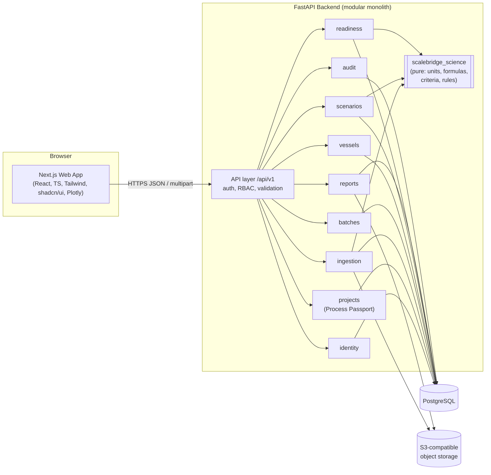
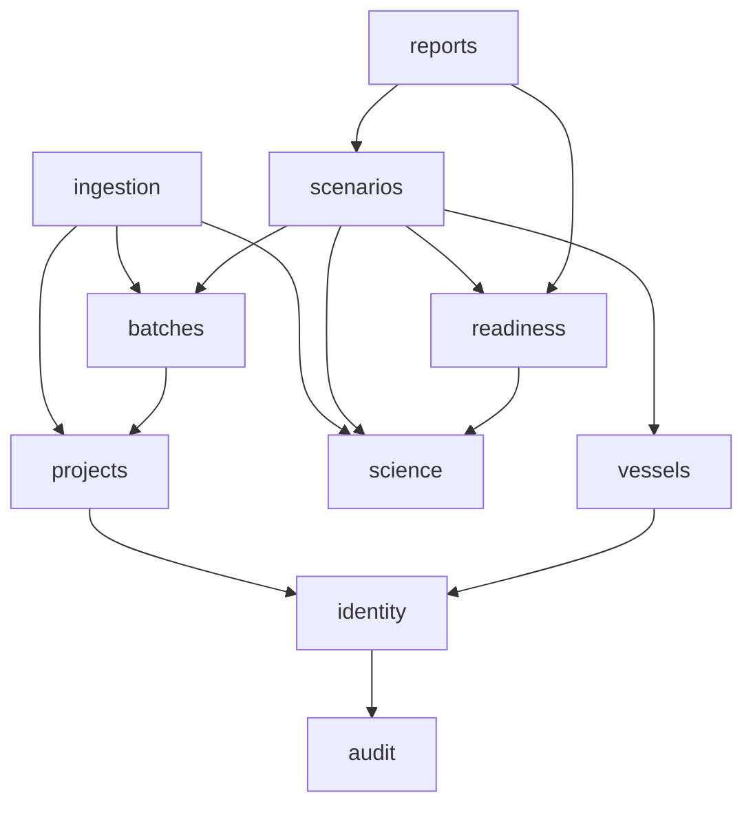
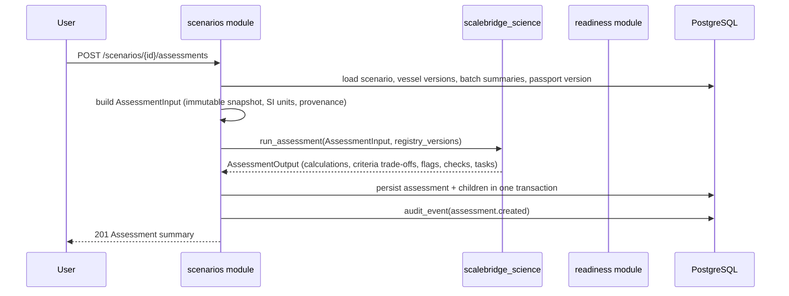

# 05 — System Architecture

**Purpose:** Define components, responsibilities, boundaries, data flow and inter-module contracts.
**Related:** [06_TECH_STACK.md](06_TECH_STACK.md) · [07_DATABASE_SCHEMA.md](07_DATABASE_SCHEMA.md) · [08_API_SPECIFICATION.md](08_API_SPECIFICATION.md) · [10_SCIENTIFIC_ENGINE.md](10_SCIENTIFIC_ENGINE.md) · [../ai-context/ARCHITECTURE_RULES.md](../ai-context/ARCHITECTURE_RULES.md)

---

## 1. Architectural style (PROPOSED)
A **modular monolith**: one Next.js frontend, one FastAPI backend containing domain modules, and one **pure Python scientific library** (`scalebridge_science`) with no I/O. PostgreSQL for records, S3-compatible object storage for files. Synchronous request handling in MVP; background workers (Celery + Redis) only if measured need arises (Blueprint lists them as *optional* `[BP p.10]`, **OQ-027**).

Rationale: four-person team, 12-week timeline `[BP p.12]`; avoid unnecessary complexity; keep the scientific engine independently testable and reviewable by the scientific lead.

## 2. Components (CONFIRMED responsibilities `[BP p.10]`, mapping PROPOSED)

| Blueprint component | Responsibility (CONFIRMED) | Implementation unit (PROPOSED) |
|---|---|---|
| Web application | User workflow, upload, charts, vessel setup, scenario review, report download | `frontend/` Next.js app |
| API / identity layer | Authentication, organization separation, RBAC, API validation | `backend/app/api`, `backend/app/modules/identity`, `backend/app/core/security` |
| Data pipeline | File parsing, schema mapping, quality checks, timestamp alignment, unit normalization | `backend/app/modules/ingestion` (uses `scalebridge_science.units`) |
| Scientific engine | Formula library, calculation provenance, engineering rules, scenario comparison | `backend/scalebridge_science/` (pure) + `backend/app/modules/scenarios` (orchestration) |
| Readiness engine | Rule-based risk flags, missing-data assessment, uncertainty labels, validation tasks | `backend/scalebridge_science/readiness/` (pure rules) + `backend/app/modules/readiness` (persistence) |
| Data storage | Relational metadata; object storage for raw datasets and reports; audit events | PostgreSQL + S3-compatible (MinIO locally) |

## 3. Module responsibilities and dependencies

| Module | Owns tables | May call | Must NOT |
|---|---|---|---|
| `identity` | organizations, users, memberships, refresh_tokens | audit | Contain business logic of other modules |
| `projects` | projects, passport_versions | identity (authz), audit | Parse files |
| `ingestion` | data_files, column_mappings, conversion_records, quality_issues | projects, batches (create), science.units, audit, storage | Compute engineering parameters |
| `batches` | batches, measurements, samples | projects, audit | Modify raw files |
| `vessels` | vessels, vessel_versions, vessel_parameters | audit | Evaluate compatibility |
| `scenarios` | scenarios, scenario_batches, assessments, calculation_results | projects, batches, vessels (read), science, readiness, audit | Write to vessels/batches |
| `readiness` | risk_flags, compatibility_checks, validation_tasks, review_signoffs | science.readiness, audit | Invent thresholds; call DB from rule code |
| `reports` | reports | scenarios/readiness (read), storage, audit | Recompute calculations (renders persisted assessment only) |
| `audit` | audit_events | — | Be updated/deleted (append-only) |
| `scalebridge_science` | none | numpy, scipy, pint, pandas | Import FastAPI, SQLAlchemy, network, clock, randomness |

Dependency direction: `api → modules → (science, db, storage)`. `science` depends on nothing in `app`. Cycles are forbidden.

## 4. Core data flow

### 4.1 Ingestion
1. `POST /files` → raw bytes to object storage (`orgs/{org_id}/raw/{file_id}/{original_name}`), SHA-256 computed, `data_files` row `uploaded`.
2. `GET /files/{id}/preview` → parsed header + first N rows + detected columns/sheets.
3. `PUT /files/{id}/mapping` → mapping stored; validation of units via `science.units`.
4. `POST /files/{id}/dry-run` → full parse, normalization, quality checks; returns quality report; **nothing committed to measurements**.
5. `POST /files/{id}/import` → transaction: create/attach batch, insert measurements/samples, conversion_records, quality_issues; status `imported`; audit event.

### 4.2 Assessment

The science library returns **everything** (calculations, flags, compatibility checks, validation tasks) as a pure function of `AssessmentInput`. Persistence is the only job of `scenarios`/`readiness` modules. This guarantees NFR-04 reproducibility.

### 4.3 Report
`POST /assessments/{id}/reports` → load persisted assessment → render HTML template (Jinja2) → PDF (WeasyPrint) → store in object storage → `reports` row with hash → return metadata; download via `GET /reports/{id}/download` (streamed, authz-checked).

## 5. Key contracts between backend modules and science library (PROPOSED)

Defined as Pydantic models in `scalebridge_science/contracts.py` (versioned with `CONTRACT_VERSION`). Full fields in [10_SCIENTIFIC_ENGINE.md](10_SCIENTIFIC_ENGINE.md) §4.

| Contract | Direction | Purpose |
|---|---|---|
| `Quantity` | both | `{value: float, unit: str, provenance, value_nature, source_ref}` |
| `VesselSpec` | in | Vessel version parameters as `Quantity` map + categorical attributes |
| `ProcessSummary` | in | Per-batch derived summaries (min DO, max OUR if supplied, operating N, gas flow, temperature, volume) with provenance |
| `MediumProperties` | in | Density, viscosity, C* (each `Quantity`, may be absent) |
| `ScenarioConfig` | in | Criteria, primary criterion, target volume, constraints, thresholds snapshot |
| `AssessmentInput` | in | All of the above + registry versions |
| `CalculationResult` | out | formula_id, version, scale, inputs, output, status, assumptions, warnings |
| `RiskFlag`, `CompatibilityCheck`, `ValidationTask` | out | See docs 12–14 |
| `AssessmentOutput` | out | Lists of above + summary + engine versions |

## 6. Cross-cutting concerns

| Concern | Approach (PROPOSED) | Doc |
|---|---|---|
| Tenancy | `organization_id` on every tenant table; enforced in repository layer via mandatory org scope; integration tests for cross-tenant access | [17](17_SECURITY_AND_PRIVACY.md) |
| Errors | Uniform error envelope; domain exceptions mapped centrally | [08](08_API_SPECIFICATION.md) §2 |
| Audit | `audit.record()` called in service layer within the same DB transaction | [07](07_DATABASE_SCHEMA.md) |
| Configuration | Pydantic Settings from env vars; no secrets in repo | [21](21_DEPLOYMENT.md) |
| Versioning | API `/api/v1`; `ENGINE_VERSION`, `FORMULA_REGISTRY_VERSION`, `RULE_REGISTRY_VERSION` semver constants | [10](10_SCIENTIFIC_ENGINE.md) |
| Logging | Structured JSON logs with `request_id`; never log measurement values or file contents | [17](17_SECURITY_AND_PRIVACY.md) |
| Time | All timestamps stored UTC `timestamptz`; display in user's local tz | [09](09_DATA_INGESTION.md) |

## 7. Later integration architecture (CONFIRMED direction, NOT MVP `[BP p.10]`)
OPC UA, Modbus TCP/RTU and MQTT through **approved equipment gateways**, **read-only**, manufacturer-approved interfaces. Planned as a separate `connectors` service writing into the same ingestion pipeline (PROPOSED). Never writes setpoints.

## 8. Implementation difficulties (identified)

| Difficulty | Mitigation |
|---|---|
| Heterogeneous controller export formats | Saved, reusable column mappings; agreed MVP schema (**OQ-024**) |
| Unit ambiguity (e.g., `%` for DO, `rpm` vs rad/s, `vvm`, `L/min` at STP vs actual) | Explicit unit registry with custom units and mandatory user confirmation ([09](09_DATA_INGESTION.md) §5) |
| Large time-series in PostgreSQL | Long-format table with composite index; downsampling for charts; TimescaleDB later if needed |
| Reproducibility across code changes | Snapshot inputs + versioned registries; old assessments are never recomputed in place |
| Scientific sign-off bottleneck | Formula register workflow with explicit `approved` status ([10](10_SCIENTIFIC_ENGINE.md) §8) |
