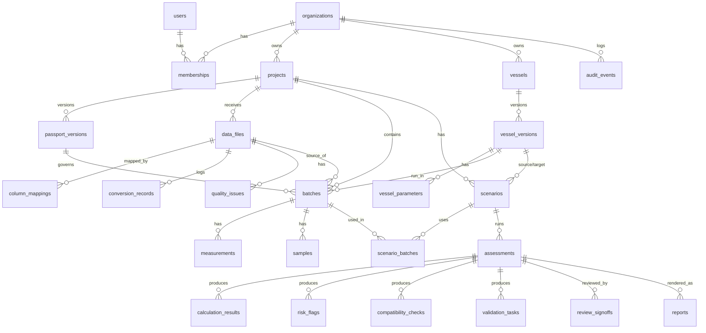

# 07 — Database Schema

**Purpose:** Define all persistent entities, columns, relationships, constraints and immutability rules for PostgreSQL.
**Related:** [05_SYSTEM_ARCHITECTURE.md](05_SYSTEM_ARCHITECTURE.md) · [08_API_SPECIFICATION.md](08_API_SPECIFICATION.md) · [09_DATA_INGESTION.md](09_DATA_INGESTION.md) · [17_SECURITY_AND_PRIVACY.md](17_SECURITY_AND_PRIVACY.md)

---

## 1. Source entities (CONFIRMED `[BP p.11]`)

| Blueprint entity | Key fields (Blueprint) | Tables (PROPOSED) |
|---|---|---|
| Organization / user | Org ID, role, access policy, project permissions | `organizations`, `users`, `memberships` |
| Project / process | Product family, organism/strain metadata, process type, recipe version, owner | `projects`, `passport_versions` |
| Bioreactor / vessel | Working volume, dimensions, impeller type/diameter, motor limit, sparger, gas & cooling capability | `vessels`, `vessel_versions`, `vessel_parameters` |
| Batch / run | Run ID, start/end, scale, vessel ID, recipe version, operator, notes | `batches` |
| Measurement | Timestamp, variable, value, unit, source, sensor/assay, quality flag | `measurements` |
| Sample / assay | Sample time, assay type, biomass, substrate, product titre, method, result, units | `samples` |
| Scenario / assessment | Target vessel, criteria, equations, assumptions, results, model version, risk flags | `scenarios`, `scenario_batches`, `assessments`, `calculation_results`, `risk_flags`, `compatibility_checks`, `validation_tasks` |
| Report / audit event | Report version, author, timestamp, inputs used, change history | `reports`, `review_signoffs`, `audit_events` |

Supporting (PROPOSED): `data_files`, `column_mappings`, `conversion_records`, `quality_issues`, `refresh_tokens`, `invitations`.

## 2. Conventions (PROPOSED)
- Primary keys: `uuid` (v7 preferred, generated app-side) except `measurements.id` and `audit_events.id` (`bigint identity`).
- Every tenant table has `organization_id uuid NOT NULL REFERENCES organizations(id)` and an index starting with `organization_id`.
- Timestamps: `timestamptz`, UTC. `created_at DEFAULT now()`.
- Enums: PostgreSQL `text` + `CHECK` constraint (easier migrations than native enums).
- Soft delete via `archived_at` for user-facing entities; **immutable** entities are never updated or deleted (enforced in service layer and by DB trigger raising on UPDATE/DELETE — PROPOSED).
- Physical quantities stored as **original value + original unit + SI value + SI unit** wherever user-supplied.
- `jsonb` only for genuinely variable structure; must have a Pydantic schema in code.

### 2.1 Shared enumerations
| Enum | Values | Label |
|---|---|---|
| `provenance` | `sensor`, `manual_entry`, `lab_assay`, `vendor_datasheet`, `published_correlation`, `user_assumption`, `calculated` | CONFIRMED (first six `[BP p.6]`), `calculated` PROPOSED |
| `value_nature` | `measured`, `estimated`, `assumed`, `calculated` | PROPOSED, implements `[BP p.6]` |
| `quality_flag` | `ok`, `suspect`, `invalid`, `missing` | PROPOSED |
| `role` | `org_admin`, `scientist`, `reviewer`, `viewer` | PROPOSED (**OQ-021**) |
| `process_type` | `batch`, `fed_batch`, `other` | CONFIRMED scope `[BP p.2]` |
| `severity` | `critical`, `high`, `medium`, `low`, `info` | PROPOSED |
| `rule_outcome` | `triggered`, `not_triggered`, `insufficient_evidence`, `not_configured` | PROPOSED |
| `calc_status` | `computed`, `insufficient_evidence`, `not_applicable`, `error` | PROPOSED |
| `compat_outcome` | `compatible`, `incompatible`, `cannot_evaluate` | PROPOSED |
| `evidence_level` | `measured`, `mixed`, `estimated`, `assumed`, `insufficient` | PROPOSED |

Mapping provenance → default value_nature: `sensor`, `lab_assay` → `measured`; `vendor_datasheet`, `manual_entry` → `measured` only if user marks it measured, else `estimated` (user must choose); `published_correlation` → `estimated`; `user_assumption` → `assumed`; `calculated` → `calculated`.

## 3. ER diagram

## 4. Table definitions

### 4.1 Identity
**organizations**: `id uuid PK`, `name text NOT NULL`, `slug text UNIQUE NOT NULL`, `data_retention_days int NULL` (null = retain until deleted by customer, **OQ-022**), `created_at`.

**users**: `id uuid PK`, `email citext UNIQUE NOT NULL`, `password_hash text NOT NULL`, `full_name text NOT NULL`, `is_active bool DEFAULT true`, `last_login_at timestamptz`, `created_at`.

**memberships**: `id uuid PK`, `organization_id FK`, `user_id FK`, `role text CHECK role`, `created_at`; `UNIQUE(organization_id, user_id)`.

**invitations**: `id`, `organization_id`, `email`, `role`, `token_hash`, `expires_at`, `accepted_at`, `invited_by FK users`.

**refresh_tokens**: `id`, `user_id`, `token_hash UNIQUE`, `expires_at`, `revoked_at`, `created_at`, `user_agent`.

### 4.2 Process Passport
**projects**: `id`, `organization_id`, `name text NOT NULL`, `product_family text`, `organism_name text`, `strain_metadata jsonb DEFAULT '{}'`, `process_type text CHECK`, `owner_user_id FK users`, `is_synthetic_demo bool NOT NULL DEFAULT false`, `created_at`, `updated_at`, `archived_at`; `UNIQUE(organization_id, name)`.

**passport_versions** *(immutable)*: `id`, `organization_id`, `project_id FK`, `version int NOT NULL`, `recipe_version text`, `process_description text`, `organism_context jsonb`, `medium_context jsonb` (medium name, composition reference, density/viscosity/C* as `Quantity` objects if known), `process_parameters jsonb` (list of `{key, value, unit, provenance, value_nature, note}` e.g., temperature setpoint, pH setpoint, DO setpoint, feed strategy), `material_context jsonb`, `change_note text`, `created_by FK users`, `created_at`; `UNIQUE(project_id, version)`.

### 4.3 Vessels
**vessels**: `id`, `organization_id`, `name text NOT NULL`, `scale_class text CHECK IN ('lab','pilot','production','other')`, `manufacturer text`, `model text`, `location text`, `created_at`, `archived_at`; `UNIQUE(organization_id, name)`.

**vessel_versions** *(immutable)*: `id`, `organization_id`, `vessel_id FK`, `version int`, `impeller_type text`, `impeller_count int`, `sparger_type text`, `instrumentation jsonb` (list of strings from controlled vocabulary, [13](13_EQUIPMENT_COMPATIBILITY.md) §3.3), `controls jsonb`, `kla_evidence jsonb DEFAULT '[]'` (list of kLa evidence points, schema in [13](13_EQUIPMENT_COMPATIBILITY.md) §3.4), `mixing_time_evidence jsonb DEFAULT '[]'` (measured mixing times with method/conditions, [11](11_SCALE_UP_CALCULATIONS.md) §7), `change_note`, `created_by`, `created_at`; `UNIQUE(vessel_id, version)`.

**vessel_parameters** *(immutable, child of version)*: `id`, `organization_id`, `vessel_version_id FK`, `key text NOT NULL` (controlled list in [13](13_EQUIPMENT_COMPATIBILITY.md) §3.2), `value_original double precision NOT NULL`, `unit_original text NOT NULL`, `value_si double precision NOT NULL`, `unit_si text NOT NULL`, `provenance text CHECK`, `value_nature text CHECK`, `source_reference text`, `note text`; `UNIQUE(vessel_version_id, key)`.

### 4.4 Ingestion
**data_files**: `id`, `organization_id`, `project_id FK`, `original_filename text`, `content_type text`, `size_bytes bigint`, `sha256 char(64)`, `storage_key text`, `status text CHECK IN ('uploaded','mapped','validated','imported','failed')`, `is_synthetic bool NOT NULL`, `source_description text NOT NULL` (where the data came from), `error_message text`, `uploaded_by`, `uploaded_at`.

**column_mappings**: `id`, `organization_id`, `data_file_id FK`, `name text NULL` (if saved as reusable template), `is_template bool`, `mapping jsonb NOT NULL` (schema in [09](09_DATA_INGESTION.md) §4), `created_by`, `created_at`.

**conversion_records**: `id`, `organization_id`, `data_file_id FK`, `variable text`, `from_unit text`, `to_unit text`, `method text` (e.g., `pint`, `user_defined_factor`), `factor double precision NULL`, `offset double precision NULL`, `pint_version text`, `created_at`.

**quality_issues**: `id`, `organization_id`, `data_file_id FK`, `batch_id FK NULL`, `check_code text` (e.g., `DQ-TS-ORDER`), `severity text`, `variable text NULL`, `row_start int NULL`, `row_end int NULL`, `count int`, `message text`, `created_at`.

### 4.5 Batches & measurements
**batches**: `id`, `organization_id`, `project_id FK`, `passport_version_id FK NULL`, `vessel_version_id FK NULL`, `data_file_id FK NULL`, `run_code text NOT NULL`, `scale_label text`, `working_volume_original double`, `working_volume_unit text`, `working_volume_si double`, `start_time timestamptz`, `end_time timestamptz`, `operator text`, `notes text`, `is_synthetic bool NOT NULL`, `created_at`, `archived_at`; `UNIQUE(project_id, run_code)`.

**measurements** *(append-only)*: `id bigint identity PK`, `organization_id`, `batch_id FK`, `ts timestamptz NOT NULL`, `elapsed_s double precision NOT NULL` (seconds from batch start), `variable text NOT NULL` (canonical key, [09](09_DATA_INGESTION.md) §3), `value_original double precision NULL`, `unit_original text`, `value_si double precision NULL`, `unit_si text`, `provenance text CHECK`, `sensor_or_assay text`, `quality_flag text CHECK`, `data_file_id FK`, `source_row int`, `supersedes_id bigint NULL FK measurements` (correction chain). Index: `(batch_id, variable, ts)`; `(organization_id)`.

**samples** *(append-only)*: `id uuid`, `organization_id`, `batch_id FK`, `sample_time timestamptz`, `elapsed_s double`, `assay_type text`, `analyte text` (canonical key e.g. `biomass_dcw`, `od600`, `substrate_glucose`, `product_titre`), `method text`, `result_original double NULL`, `unit_original text`, `result_si double NULL`, `unit_si text`, `quality_flag`, `data_file_id`, `source_row`, `notes`.

### 4.6 Scenarios & assessments
**scenarios** (editable until first assessment; afterwards edits create a copy — PROPOSED): `id`, `organization_id`, `project_id FK`, `name`, `source_vessel_version_id FK`, `target_vessel_version_id FK`, `target_working_volume_original double`, `target_working_volume_unit text`, `target_working_volume_si double`, `criteria jsonb` (`[{criterion_id, is_primary}]` — agitation criteria S-PV/S-TIP, optional S-KLA), `aeration_basis text CHECK IN ('S-VVM','S-VS')`, `kla_selection jsonb` (`{source_point_id, target_point_id}` referencing vessel kLa evidence points, nullable), `batch_window jsonb` (per batch `{from_s, to_s}`; null = whole batch), `statistic_overrides jsonb` (per input, see [11](11_SCALE_UP_CALCULATIONS.md) §2.3), `constraints jsonb` (user process constraints as `Quantity` list, e.g., `max_tip_speed`, `min_do_required`, `estimated_heat_load`), `assumptions jsonb` (explicit user assumptions: medium density/viscosity/C* if not in passport, each with provenance `user_assumption`), `created_by`, `created_at`, `updated_at`, `locked_at`.

**scenario_batches**: `scenario_id FK`, `batch_id FK`, `organization_id`; PK `(scenario_id, batch_id)`.

**assessments** *(immutable)*: `id`, `organization_id`, `scenario_id FK`, `status text CHECK IN ('completed','failed')`, `engine_version text`, `contract_version text`, `formula_registry_version text`, `rule_registry_version text`, `threshold_config_version text`, `pint_version text`, `inputs_snapshot jsonb NOT NULL` (full `AssessmentInput`), `summary jsonb` (counts by outcome/severity, overall evidence level), `is_synthetic bool`, `error_message text`, `created_by`, `created_at`.

**calculation_results** *(immutable)*: `id`, `organization_id`, `assessment_id FK`, `formula_id text`, `formula_version text`, `scale text CHECK IN ('source','target')`, `criterion_id text NULL` (null = descriptor at source/target baseline; set = value under that criterion's operating point), `inputs jsonb` (map name → Quantity), `output_value_si double NULL`, `output_unit_si text`, `display_value double NULL`, `display_unit text`, `value_nature text`, `evidence_level text`, `status text CHECK calc_status`, `missing_inputs text[]`, `assumptions jsonb`, `warnings jsonb`, `sort_order int`.

**risk_flags** *(immutable)*: `id`, `organization_id`, `assessment_id FK`, `rule_id text`, `rule_version text`, `category text CHECK IN ('oxygen_transfer','mixing','thermal','data','equipment')`, `severity text`, `outcome text CHECK rule_outcome`, `title text`, `explanation text`, `input_refs jsonb` (list of `{kind: 'vessel_parameter'|'measurement_summary'|'scenario_input'|'calculation', ref_id, key}`), `calculation_result_ids uuid[]`, `evidence_gap text NULL`, `threshold_used jsonb NULL`.

**compatibility_checks** *(immutable)*: `id`, `organization_id`, `assessment_id FK`, `check_id text`, `criterion_id text NULL`, `parameter_key text`, `required_value_si double NULL`, `capability_min_si double NULL`, `capability_max_si double NULL`, `unit_si text`, `outcome text CHECK compat_outcome`, `explanation text`, `input_refs jsonb`.

**validation_tasks** (mutable status only): `id`, `organization_id`, `assessment_id FK`, `task_code text`, `task_type text CHECK IN ('measurement','experiment','expert_review','data_request')`, `title`, `description`, `priority text CHECK IN ('P1','P2','P3')`, `linked_risk_flag_ids uuid[]`, `linked_check_ids uuid[]`, `status text CHECK IN ('open','in_progress','done','waived') DEFAULT 'open'`, `waived_reason text`, `assignee_user_id FK NULL`, `updated_by`, `updated_at`. Constraint: `status <> 'waived' OR waived_reason IS NOT NULL`.

**review_signoffs** *(append-only)*: `id`, `organization_id`, `assessment_id FK`, `reviewer_user_id FK`, `decision text CHECK IN ('approved_for_discussion','changes_requested')`, `comment text NOT NULL`, `created_at`.

### 4.7 Reports & audit
**reports** *(immutable)*: `id`, `organization_id`, `assessment_id FK`, `version int`, `status text CHECK IN ('generated','failed')`, `storage_key`, `sha256`, `size_bytes`, `template_version text`, `is_synthetic bool`, `generated_by`, `generated_at`; `UNIQUE(assessment_id, version)`.

**audit_events** *(append-only)*: `id bigint identity`, `organization_id NULL` (null for login failures without org), `actor_user_id NULL`, `action text` (e.g., `project.created`, `file.imported`, `assessment.created`, `report.downloaded`, `membership.role_changed`), `entity_type text`, `entity_id text`, `occurred_at timestamptz`, `request_id text`, `ip inet`, `details jsonb` (no measurement values). Index `(organization_id, occurred_at DESC)`.

## 5. Immutability and versioning rules (CONFIRMED intent `[BP p.11]`)
| Entity | Rule |
|---|---|
| passport_versions, vessel_versions, vessel_parameters | Insert-only; edit = new version |
| measurements, samples | Insert-only; correction = new row with `supersedes_id`; queries use latest non-superseded |
| assessments + children (except validation_task status) | Insert-only |
| reports, review_signoffs, audit_events | Insert-only |
| Raw files in object storage | Never overwritten; object lock/versioning enabled where supported |

## 6. Deletion & retention (CONFIRMED customer-controlled retention `[BP p.10]`)
Org admin can request deletion of a project → hard delete of tenant rows + objects after a grace period (PROPOSED 30 days), audit event retained without content. Retention policy defaults: **OQ-022**.

## 7. Acceptance criteria
- Alembic migration from empty DB creates all tables; downgrade works.
- Integration test: every tenant table has non-null `organization_id` and org-scoped index.
- Trigger/service tests: UPDATE on immutable tables fails.
- Every enum in code matches the CHECK constraint (generated test).
