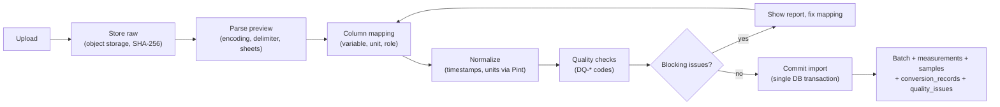

# 09 — Data Ingestion

**Purpose:** Specify how batch data files become trustworthy, unit-normalized, quality-checked measurements without losing the raw record.
**Related:** [07_DATABASE_SCHEMA.md](07_DATABASE_SCHEMA.md) §4.4–4.5 · [08_API_SPECIFICATION.md](08_API_SPECIFICATION.md) §3.3 · [10_SCIENTIFIC_ENGINE.md](10_SCIENTIFIC_ENGINE.md) §3 · [16_USER_WORKFLOWS.md](16_USER_WORKFLOWS.md) WF-2

---

## 1. Requirements (CONFIRMED `[BP p.5, p.6, p.11]`)
- CSV/XLSX upload; column mapping; timestamps; units; missing values; batch metadata.
- Preserve source files; never silently overwrite raw values.
- Check timestamp order, gaps, duplicate points, impossible values, out-of-range sensor readings.
- Keep original units and normalized units; record every conversion. Use a unit-aware library (Pint).
- Make missing data visible; prevent unsupported calculations.
- Track calibration status and measurement provenance where available.
- **Acceptance test:** a user can import one complete batch and see a data-quality summary.
- **Metric:** ≥90% of files in the agreed MVP schema import without manual rework `[BP p.14]`.

## 2. Pipeline



Statuses on `data_files`: `uploaded → mapped → validated → imported` or `failed` (PROPOSED).

## 3. Canonical variables (PROPOSED controlled vocabulary)

Measurement variables (time series, `measurements.variable`):

| Key | Description | Accepted input units (examples) | Internal unit | Display unit |
|---|---|---|---|---|
| `ph` | pH | `pH` (dimensionless) | dimensionless | pH |
| `dissolved_oxygen` | DO relative to air saturation | `%`, `% air sat` | `percent_air_saturation` (custom dimensionless) | % air sat |
| `dissolved_oxygen_conc` | DO as concentration (if instrument reports) | mg/L, mmol/L | mol/m³ | mmol/L |
| `temperature` | Broth temperature | °C, K, °F | K (stored also as original) | °C |
| `agitation_speed` | Impeller rotational speed | rpm, 1/min, 1/s | 1/s (rev/s) | rpm |
| `airflow` | Air flow to sparger | L/min, SLPM, m³/h, mL/min | m³/s | L/min |
| `oxygen_flow` | Pure O₂ supplementation flow | as airflow | m³/s | L/min |
| `gas_flow_total` | Total gas flow | as airflow | m³/s | L/min |
| `headspace_pressure` | Vessel pressure | bar(g), bar(a), kPa, psi | Pa (absolute; gauge requires user to confirm atmospheric reference) | bar(a) |
| `feed_rate` | Feed pump rate | mL/h, L/h, g/h | m³/s or kg/s (by declared basis) | mL/h |
| `feed_cumulative` | Cumulative feed | mL, L, g | m³ or kg | mL |
| `working_volume` | Liquid volume over time | L, mL | m³ | L |
| `offgas_o2` | Exhaust O₂ fraction | %, mol/mol | dimensionless fraction | % |
| `offgas_co2` | Exhaust CO₂ fraction | %, mol/mol | dimensionless fraction | % |
| `our` | Oxygen uptake rate — **user-supplied only** (not computed in MVP, OQ-016) | mmol/(L·h) | mol/(m³·s) | mmol/(L·h) |
| `cer` | CO₂ evolution rate — user-supplied only | mmol/(L·h) | mol/(m³·s) | mmol/(L·h) |
| `base_cumulative`, `acid_cumulative`, `antifoam_cumulative` | Additions | mL, g | m³ / kg | mL |
| `power_draw` | Measured shaft/motor power if logged | W, kW | W | W |

Sample analytes (`samples.analyte`): `od600` (dimensionless AU), `biomass_dcw` (g/L → kg/m³), `substrate_<name>` (g/L), `product_titre` (g/L or activity units — activity units such as U/mL stored with original unit and **no SI conversion**, PROPOSED), `other:<name>`.

Variables outside the vocabulary may be imported as `custom:<slug>`; they are charted but never used by the scientific engine.

> OPEN QUESTION **OQ-024**: Which variables are mandatory for the "agreed MVP schema"? Proposed minimum for a batch to be scenario-eligible: timestamp, `agitation_speed`, `airflow`, `dissolved_oxygen`, `temperature`, `working_volume` (series or constant metadata).

## 4. Column mapping contract (PROPOSED)

(JSON with explanatory comments; comments are not part of the payload.)

```jsonc
{
  "sheet": "Data",
  "header_row": 1,
  "timestamp": {
    "column": "Time",
    "kind": "absolute",                       // "absolute" | "elapsed"
    "format": "%d/%m/%Y %H:%M:%S",            // required for absolute unless ISO 8601
    "timezone": "Asia/Kolkata",               // required for absolute naive timestamps
    "elapsed_unit": null                      // e.g. "h", "min", "s" when kind = "elapsed"
  },
  "batch_start": "2026-10-01T04:30:00Z",      // required when kind = elapsed
  "columns": [
    { "source": "DO [%]", "variable": "dissolved_oxygen", "unit": "percent_air_saturation",
      "provenance": "sensor", "sensor_or_assay": "DO probe 1", "calibration_status": "calibrated_pre_run" },
    { "source": "Stirrer [rpm]", "variable": "agitation_speed", "unit": "rpm", "provenance": "sensor" },
    { "source": "Air [slpm]", "variable": "airflow", "unit": "SLPM", "provenance": "sensor",
      "gas_reference_conditions": "OQ-032: standard T/P must be declared" },
    { "source": "Comment", "variable": null }
  ],
  "missing_value_tokens": ["", "NA", "N/A", "-", "NaN", "#VALUE!"],
  "decimal_separator": ".",
  "samples_sheet": { "sheet": "Offline", "...": "same structure with analyte instead of variable" }
}
```

Rules:
- Every mapped column must have a unit accepted for that variable (`GET /science/units`); otherwise `DQ-UNIT-UNKNOWN` (blocking).
- Ambiguous units (`%` for DO, `slpm` without reference conditions, gauge vs absolute pressure) require explicit user confirmation; stored in mapping (`DQ-UNIT-AMBIGUOUS`, blocking until confirmed).
- `calibration_status` ∈ `calibrated_pre_run`, `calibrated_unknown_date`, `not_calibrated`, `unknown` (default `unknown`). CONFIRMED intent "track calibration status where available" `[BP p.11]`.

## 5. Unit normalization (CONFIRMED Pint `[BP p.6, p.10]`; specifics PROPOSED)
- A single shared `UnitRegistry` lives in `scalebridge_science.units`; ingestion and the engine import the same instance.
- Custom unit definitions (version-controlled): `percent_air_saturation = [dimensionless_do]` (own dimension so it can never be silently converted to concentration), `vvm = 1/minute`, `SLPM` (only after reference conditions are declared — **OQ-032**), `pH = dimensionless`.
- Rotational speed: `rpm` converted to **1/s numeric revolutions per second**. Do **not** convert via radians (Pint `revolution` = 2π rad would introduce a 2π error in `u_tip = π N D`). Unit test required.
- Temperature: offset units handled with Pint `Quantity` (not multiplication); stored original °C and SI K.
- Each (variable, from_unit, to_unit) pair applied to a file writes one `conversion_records` row incl. `pint_version`.
- Original and SI values both persisted per row.

## 6. Timestamp handling
- Absolute timestamps parsed with declared format/timezone, converted to UTC.
- Elapsed timestamps converted to absolute via `batch_start`.
- `elapsed_s` computed from batch start (first valid timestamp if start not given).
- Rows with unparseable timestamps are excluded and counted (`DQ-TS-PARSE`); if >5% (PROPOSED), import is blocking.
- Timestamp alignment across variables in one file is by row; across files (e.g., offline samples) by timestamp — no interpolation in storage; charts may align by `elapsed_s`.

## 7. Data-quality checks (CONFIRMED list `[BP p.11]`; codes & defaults PROPOSED)

| Code | Check | Severity | Blocking | Configurable parameter |
|---|---|---|---|---|
| `DQ-FILE-EMPTY` | No data rows | critical | yes | — |
| `DQ-COL-UNMAPPED` | Columns not mapped (informational) | info | no | — |
| `DQ-UNIT-UNKNOWN` | Unit not accepted for variable | critical | yes | — |
| `DQ-UNIT-AMBIGUOUS` | Ambiguous unit not confirmed | high | yes | — |
| `DQ-TS-PARSE` | Unparseable timestamps | high | if > `max_ts_parse_fail_pct` (5%) | `max_ts_parse_fail_pct` |
| `DQ-TS-ORDER` | Timestamps not monotonically increasing | high | no (rows sorted, issue recorded) | — |
| `DQ-TS-DUP` | Duplicate timestamps (same variable) | medium | no (both kept, second flagged `suspect`) | — |
| `DQ-TS-GAP` | Gap > configured max interval | medium | no | `max_gap_s` per variable (**default null = check reports gaps > 10× median interval**) |
| `DQ-VAL-MISSING` | Missing values per variable | low/medium by % | no | — |
| `DQ-VAL-IMPOSSIBLE` | Physically impossible value: pH < 0 or > 14; negative DO, flows, volumes, concentrations, speeds; temperature < 0 K | high | no (value flagged `invalid`) | — (physical bounds, not process heuristics) |
| `DQ-VAL-RANGE` | Outside sensor/instrument range declared by user or vessel profile | medium | no (flagged `suspect`) | per-sensor min/max (none by default) |
| `DQ-CAL-UNKNOWN` | Calibration status unknown for DO/pH | low | no | — |
| `DQ-META-MISSING` | Required batch metadata missing (run_code, start, vessel) | medium | run_code: yes | — |

Quality flags are attached to measurement rows; **values are never altered or removed**. Downstream summaries exclude `invalid` points and report how many were excluded.

## 8. Batch summaries for the scientific engine (PROPOSED)
`GET /batches/{id}/summary` and the scenario builder compute, per variable over a user-selectable time window (default: whole batch): `count, count_valid, min, p05, median, p95, max, mean` in SI with provenance and quality counts. Which statistic feeds which calculation is defined in [11](11_SCALE_UP_CALCULATIONS.md) §2.3 and must be shown to the user as an assumption.

## 9. Error handling
| Failure | Behaviour |
|---|---|
| Upload interrupted | No DB row created unless object stored successfully |
| Parse error | `data_files.status = failed`, `error_message`, 422 `INGESTION_ERROR` with row/column details |
| Import transaction fails | Full rollback; file remains `validated`; retry allowed |
| Duplicate file (same SHA-256 in same project) | Warning (not block) with link to prior import |
| Re-import into existing batch | Allowed only for new variables/time ranges; overlapping (variable, ts) rows create superseding records with audit event |

## 10. Acceptance criteria
1. Golden test files (`sample-data/synthetic/*`) covering CSV, XLSX multi-sheet, elapsed hours, absolute timestamps with timezone, missing tokens, duplicate timestamps, gaps, impossible values, unknown units produce the expected `QualityReport` (snapshot tests).
2. Raw file SHA-256 in DB equals hash of object in storage.
3. For every imported value: `value_si == convert(value_original, unit_original → unit_si)` (property test).
4. `rpm → 1/s` conversion test: 60 rpm → 1.0 1/s.
5. No measurement row is updated in place (DB trigger test).
