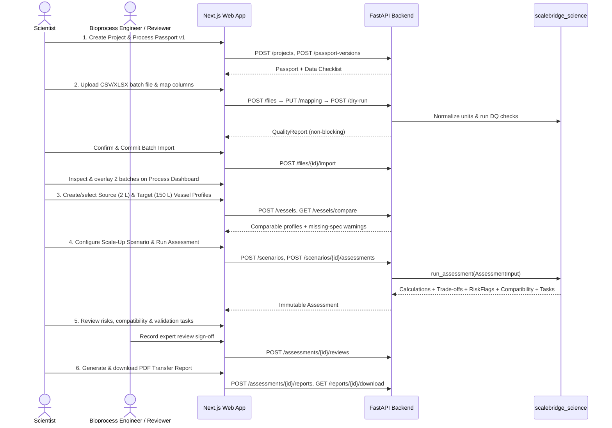

# 16 — User Workflows

**Purpose:** Trace the end-to-end user journeys across the six Blueprint stages `[BP p.4]`.
**Related:** [02_PROBLEM_AND_SOLUTION.md](02_PROBLEM_AND_SOLUTION.md) · [08_API_SPECIFICATION.md](08_API_SPECIFICATION.md) · [15_UI_UX_SPECIFICATION.md](15_UI_UX_SPECIFICATION.md)

---

## 1. End-to-end workflow overview (CONFIRMED `[BP p.4]`)

## 2. Detailed workflows

### WF-1: Create Process Passport & inspect Data Checklist
1. User creates a project (`name`, `product_family`, `organism_name`, `process_type`, `is_synthetic_demo`).
2. User enters Passport v1: recipe version, medium properties ($\rho, \mu, C^*$ if known, with provenance), setpoints (temperature, pH, DO), and feed strategy.
3. System immediately computes `GET /projects/{id}/data-checklist` showing which downstream formulas are ready vs blocked by missing medium or vessel data.

### WF-2: Import batch data & compare batches
1. User uploads CSV/XLSX and declares `is_synthetic` and `source_description`.
2. Preview displays detected columns; user maps columns to canonical variables (`ph`, `dissolved_oxygen`, `temperature`, `agitation_speed`, `airflow`, etc.) and selects units and timestamp mode (`elapsed` or `absolute`).
3. User runs **Dry-Run Validation** (`POST /files/{id}/dry-run`): inspects row count, missing counts, unit conversions, and `DQ-*` issues.
4. If no blocking issues exist, user enters batch metadata (`run_code`, `working_volume`, vessel link) and commits import.
5. User repeats for a second batch and opens the **Process Dashboard** to overlay both batches by elapsed hours.

### WF-3: Describe and compare vessels
1. User creates source benchtop vessel (e.g., 2 L) and target pilot vessel (e.g., 150 L / 200 L) with geometry, impeller type/diameter/$N_p$, motor limits, agitation/aeration ranges, cooling capacity, instrumentation, and any $k_La$ evidence points.
2. UI highlights missing specifications (`missing_specifications` list).
3. User opens `/vessels` comparison view to verify geometric ratios ($D/T$, $H_L/T$) and capability envelopes side-by-side.

### WF-4: Run scale-up scenario & review readiness
1. User selects source batch(es), source vessel version, target vessel version, target working volume, primary criterion (e.g., `S-PV`), secondary criteria (`S-TIP`, `S-KLA`), aeration basis (`S-VVM` or `S-VS`), constraints, and explicit assumptions.
2. User clicks **Run Assessment**.
3. User inspects:
   - **Calculations tab:** source and target descriptors with full equations, inputs, units, provenance, and assumptions.
   - **Trade-offs tab:** side-by-side matrix showing how holding $P/V$ constant changes tip speed and $Re$, and vice versa.
   - **Equipment Compatibility tab:** check outcomes (`compatible`, `incompatible`, `cannot_evaluate`).
   - **Risk Register tab:** flags grouped by category (`oxygen_transfer`, `mixing`, `thermal`, `equipment`, `data`) with clickable evidence links.

### WF-5: Plan validation, sign off, and export Transfer Report
1. User opens **Validation Planner** tab: reviews generated `P1`/`P2`/`P3` tasks, updates statuses or records a waiver with mandatory reason.
2. Reviewer records a sign-off decision (`approved_for_discussion` or `changes_requested`) with commentary.
3. User generates a versioned PDF **Transfer Report** containing all sections, disclaimers, and synthetic-data watermark (if applicable).
